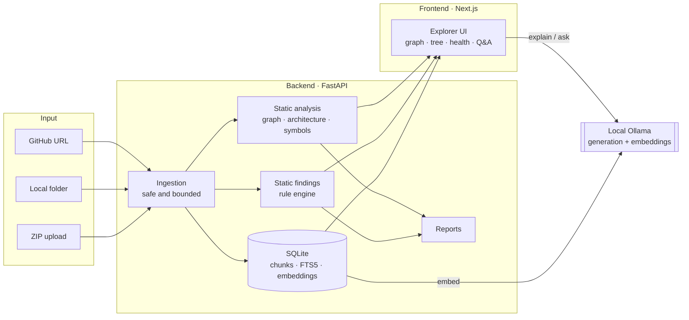

# CodeMap

**Understand any codebase locally: dependency graphs, architecture health, static findings, and AI explanations powered by your own Ollama model.**

CodeMap takes a public GitHub repository, a local folder, or a ZIP upload and turns it into an interactive map. It shows which files import which, where the architectural hotspots are, and what the likely risks look like. It also answers project-scoped questions using real source excerpts. Repository code is **parsed as text and never executed**, and AI requests go only to a local Ollama endpoint.


---

## Contents

- [Features](#features)
- [How it works](#how-it-works)
- [Quick start](#quick-start)
- [Configuration](#configuration)
- [Project structure](#project-structure)
- [Documentation](#documentation)
- [Safety model](#safety-model)
- [Status and roadmap](#status-and-roadmap)
- [License](#license)

---

## Features

| Area | What you get | Where it lives |
|---|---|---|
| **Ingestion** | GitHub URL, local folder, or ZIP upload. ZIPs are inspected in memory only. | `routes/analysis.py`, `services/zip_scanner.py` |
| **Dependency graph** | Python and JS/TS import resolution, folder grouping, an interactive React Flow canvas, and PNG and Mermaid export. | `services/analyzer.py`, `frontend/lib/graph.ts` |
| **Architecture intelligence** | Candidate entry points, framework detection, API route mapping, cross-module links, and circular dependency detection. | `services/analyzer.py` |
| **Architecture health** | Per-module complexity and risk scores, a health grade, and human-readable risk factors. | `services/analyzer.py` |
| **Symbol intelligence** | Functions and classes, resolved call edges, inheritance links, dead-code candidates, and duplicate-function groups. | `services/analyzer.py` |
| **Static findings** | About 28 explainable rules: AST logic checks for Python, cross-file import checks, dynamic SQL, command execution, disabled TLS verification, and more. | `services/bug_detector.py` |
| **Local AI explanations** | Explain a file, explain a finding, or explain the architecture report, all through your local Ollama model. | `routes/ai.py` |
| **Codebase Q&A** | Ask questions about one project. Retrieval combines SQLite FTS5/BM25 with local embeddings using reciprocal-rank fusion, and falls back to keyword search if embeddings are unavailable. | `services/code_index.py` |
| **Large repositories** | Incremental re-analysis (changed files only), cached findings and import extraction, background embedding jobs, and concurrent GitHub blob fetching. Up to 1,000 analyzed files and 64 MB of source per run. | `services/code_index.py`, `services/bug_detector.py` |
| **Reports** | Downloadable architecture, quality, and security PDF; a full JSON export; and SQLite-backed before/after snapshots with deltas. | `routes/reports.py` |

---

## How it works



For a deeper walkthrough of modules and data flow, see [docs/ARCHITECTURE.md](docs/ARCHITECTURE.md).

---

## Quick start

**Prerequisites:** Python 3.11+, Node.js 20+, and [Ollama](https://ollama.com). Ollama is optional, because everything except AI explanations works without it.

```bash
# 1. Backend
cd backend
python -m venv .venv
source .venv/bin/activate          # Windows: .venv\Scripts\Activate.ps1
pip install -r requirements-dev.txt   # runtime + test tooling
cp ../.env.example ../.env
uvicorn app.main:app --reload         # http://127.0.0.1:8000 · interactive docs at /docs

# 2. Frontend (second terminal)
cd frontend
npm install
npm run dev                        # http://localhost:3000
```

Optional local AI:

```bash
ollama pull hf.co/bartowski/Qwen_Qwen3.5-9B-GGUF:Q6_K   # generation model
ollama pull nomic-embed-text                            # semantic search (optional)
```

Step-by-step instructions, including Windows PowerShell, are in [docs/development.md](docs/development.md).

---

## Configuration

All backend settings live in `.env`, which you create from `.env.example`. Nothing secret is exposed to the frontend bundle.

| Variable | Default | Purpose |
|---|---|---|
| `OLLAMA_BASE_URL` | `http://127.0.0.1:11434` | Local Ollama endpoint. Keep it on localhost. |
| `OLLAMA_MODEL` | `hf.co/bartowski/Qwen_Qwen3.5-9B-GGUF:Q6_K` | Generation model for explanations and Q&A. |
| `CODEMAP_EMBEDDING_MODEL` | `nomic-embed-text` | Embedding model for semantic retrieval. |
| `OLLAMA_REQUEST_TIMEOUT_SECONDS` | `240` | Timeout for generation requests. |
| `CODEMAP_DATABASE_URL` | `sqlite:///./data/codemap.db` | Local SQLite store for chunks, embeddings, and snapshots. |
| `CODEMAP_MAX_UPLOAD_MB` | `50` | Maximum ZIP upload size. |
| `CODEMAP_MAX_ARCHIVE_FILES` | `5000` | Maximum number of entries in one archive. |
| `CODEMAP_MAX_EXTRACTED_MB` | `250` | Maximum declared uncompressed size. |
| `CODEMAP_MAX_SOURCE_FILE_MB` | `2` | Per-file size limit during inspection. |
| `NEXT_PUBLIC_API_URL` | `http://127.0.0.1:8000` | Frontend-to-backend URL. |

---

## Project structure

```
CodeMAP/
├── .github/workflows/ci.yml        # Backend tests + frontend production build
├── backend/
│   ├── app/
│   │   ├── main.py                 # FastAPI app, CORS, router registration
│   │   ├── routes/                 # HTTP layer: validation, status codes, orchestration
│   │   │   ├── repository.py       #   inspect a GitHub repo or ZIP (no analysis)
│   │   │   ├── source.py           #   bounded single-file preview from GitHub
│   │   │   ├── analysis.py         #   full analysis: GitHub, folder, ZIP, jobs, index
│   │   │   ├── ai.py               #   Ollama: status, prepare, explain, Q&A
│   │   │   └── reports.py          #   PDF, JSON, snapshots, comparisons
│   │   ├── services/               # Domain logic (no HTTP concerns)
│   │   │   ├── analyzer.py         #   graph, architecture, symbols, health
│   │   │   ├── bug_detector.py     #   static finding rules
│   │   │   ├── code_index.py       #   SQLite chunks, FTS5, embeddings, jobs
│   │   │   ├── repository_scanner.py   # GitHub inventory
│   │   │   └── zip_scanner.py      #   safe, in-memory ZIP reading
│   │   └── models/                 # Reserved for shared API schemas
│   ├── tests/                      # pytest suite
│   ├── requirements.txt            # runtime dependencies
│   └── requirements-dev.txt        # + pytest
├── frontend/
│   ├── app/                        # Next.js App Router: page, layout, styles
│   ├── components/                 # Reusable UI building blocks
│   ├── lib/                        # Typed API config, graph and tree helpers
│   └── package.json
├── docs/                           # Architecture, API, security, analysis, setup
├── .env.example
└── README.md
```

---

## Documentation

| Document | Read it when you want to… |
|---|---|
| [docs/ARCHITECTURE.md](docs/ARCHITECTURE.md) | Understand the modules, data flow, storage, and design decisions. |
| [docs/API.md](docs/API.md) | Call the REST API directly. Every endpoint is listed with its request and response shapes. |
| [docs/SECURITY.md](docs/SECURITY.md) | Review the threat model, the controls in place, and known limitations. |
| [docs/ANALYSIS.md](docs/ANALYSIS.md) | Read the full codebase review: quality scorecard, findings, and prioritized roadmap. |
| [docs/development.md](docs/development.md) | Set up a development environment on Windows, macOS, or Linux, and run the tests. |
| [docs/ollama-setup.md](docs/ollama-setup.md) | Configure local models and see exactly what is sent to Ollama. |

---

## Safety model

- **Untrusted input everywhere.** GitHub content, ZIP entries, and uploaded folders are treated as data.
- **Nothing is executed.** Repository code is parsed with Python's `ast` module and with regular expressions. It is never imported, evaluated, or run.
- **ZIP hardening.** Path traversal, absolute paths, backslashes, symlinks, encrypted entries, duplicate names, and oversized archives are rejected. Archives are never extracted to disk.
- **Local-only AI.** Prompts and source excerpts go only to `OLLAMA_BASE_URL`. No hosted AI provider is configured.
- **Findings are hypotheses.** Static findings are presented as potential issues, and the scanner attaches a note that they need human review.

The full threat model and its known limitations are in [docs/SECURITY.md](docs/SECURITY.md).

---

## Status and roadmap

CodeMap is in **beta**. All five planned feature areas are implemented: static bug detection, semantic retrieval, architecture intelligence, large-repository processing, and reporting. The backend test suite runs in CI on pushes and pull requests to `main`. Automated tests cover the backend only, and the frontend has no automated tests yet.

Prioritized next steps are in [docs/ANALYSIS.md](docs/ANALYSIS.md#8-prioritized-roadmap).

---

## License

Released under the MIT License.
