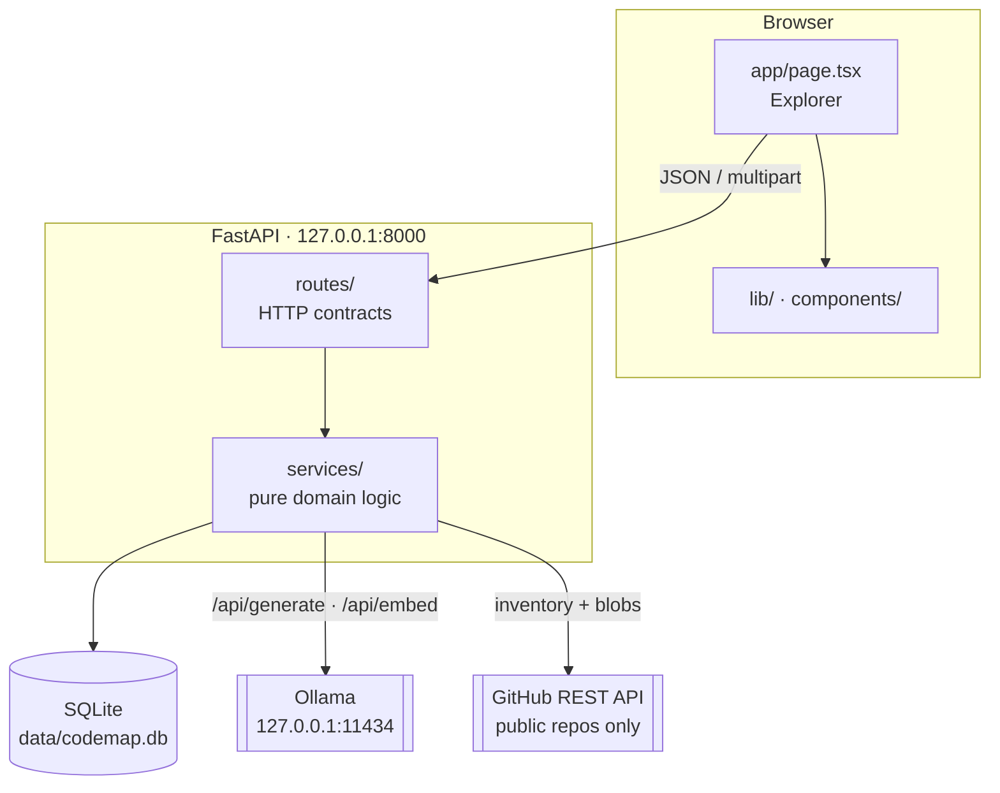
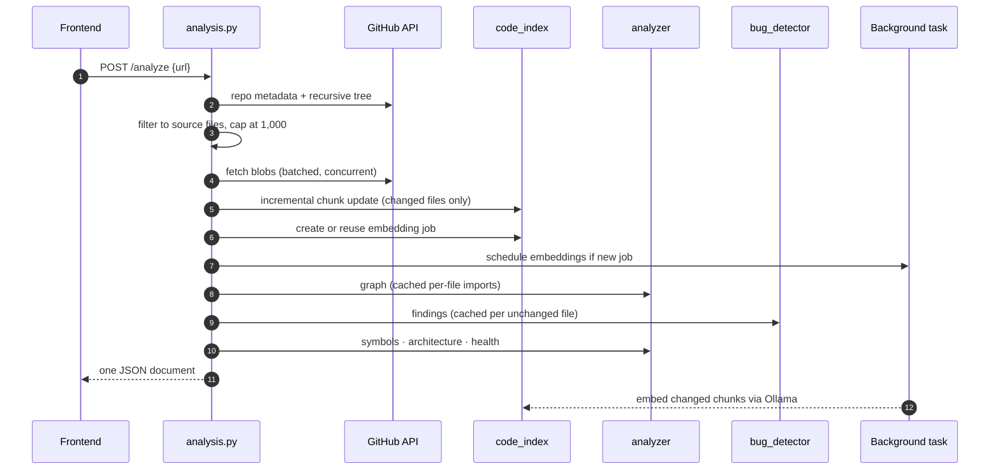
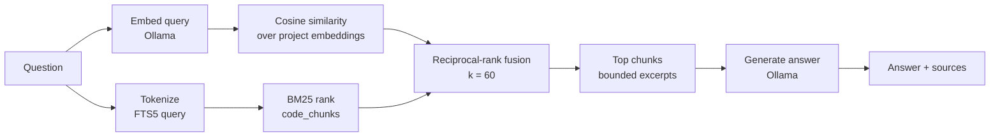

# Architecture

This document describes how CodeMap is put together: the layers, the modules inside them, how data moves through an analysis, and where state is stored.

- [1. Big picture](#1-big-picture)
- [2. Backend layers](#2-backend-layers)
- [3. Module map](#3-module-map)
- [4. Analysis pipeline](#4-analysis-pipeline)
- [5. Codebase Q&A pipeline](#5-codebase-qa-pipeline)
- [6. Storage model](#6-storage-model)
- [7. Frontend structure](#7-frontend-structure)
- [8. Design decisions](#8-design-decisions)
- [9. Known architectural debt](#9-known-architectural-debt)

---

## 1. Big picture

CodeMap is a local-first client and server pair. A Next.js client talks to a FastAPI server over JSON and multipart HTTP. The server does all parsing, analysis, and storage. It calls a local Ollama instance only when the user asks for AI output. There is no hosted dependency.



---

## 2. Backend layers

The backend uses a deliberately thin three-layer split.

| Layer | Responsibility | Must not |
|---|---|---|
| **Routes** (`app/routes/`) | Parse and validate requests with Pydantic, map domain errors to HTTP status codes, and orchestrate services. | Contain parsing or scoring logic. |
| **Services** (`app/services/`) | Pure analysis: graph building, rules, chunking, SQLite access, and ZIP or GitHub I/O. | Know about HTTP, request objects, or status codes. |
| **Models** (`app/models/`) | Reserved for shared schemas. Currently empty; Pydantic models live beside their routes. | (Not yet used.) |

Errors follow one convention. Domain errors such as `ArchiveError` or `RepositoryError` are `ValueError` subclasses raised by services and converted to `400` in routes. Unexpected upstream failures are converted to `502`.

---

## 3. Module map

### Routes

| File | Endpoints | Notes |
|---|---|---|
| `main.py` | `/api/health`, router registration, CORS | CORS allows only `localhost:3000` and `127.0.0.1:3000`. |
| `routes/repository.py` | `POST /api/repository/github`, `POST /api/repository/zip` | Inventory only. Nothing is analyzed. |
| `routes/source.py` | `POST /api/repository/source` | Single-file preview. Validates the path against the inventory. |
| `routes/analysis.py` | `/analyze`, `/analyze-folder`, `/analyze-zip`, `/jobs/{id}`, `DELETE /index/{id}` | Orchestrates the full pipeline, described in §4. |
| `routes/ai.py` | `/status`, `/prepare`, `/explain`, `/explain-bug`, `/explain-architecture`, `/ask-codebase` | Ollama client. Streams explanation output. |
| `routes/reports.py` | `/architecture.pdf`, `/snapshots`, `/compare/{project_id}` | PDF built with ReportLab. Snapshots stored in SQLite. |

### Services

| File | Lines (approx.) | Responsibility |
|---|---|---|
| `analyzer.py` | ~860 | Import extraction, dependency graph, incremental graph cache, architecture insights, code intelligence (bottlenecks, reachability, dead files), architecture health scoring, symbol intelligence (functions, classes, call and inheritance edges), and framework-aware advanced architecture. |
| `bug_detector.py` | ~520 | Static findings. Python AST rules, cross-file Python and JS/TS import checks, and a table of regex patterns for JS/TS and other languages. Incremental rescans reuse cached findings. |
| `code_index.py` | ~700 | SQLite access. Language-aware chunking, FTS5 index, the embedding table, background embedding jobs, hybrid search with reciprocal-rank fusion (k = 60), and per-project cleanup. |
| `repository_scanner.py` | ~75 | GitHub URL parsing and recursive-tree inventory. |
| `zip_scanner.py` | ~150 | Safe ZIP validation and bounded in-memory reads. |

---

## 4. Analysis pipeline

Every analysis route follows the same stages. The GitHub route is the most complete example.



Key properties of the pipeline:

- **Stable identity.** `make_stable_project_id(repository, branch)` makes a repository's project ID the same across runs, so incremental caches stay valid.
- **Change detection.** Each file gets a content hash. Only changed or removed files touch the chunk table, the import cache, and the findings cache.
- **Pruning guard.** Missing rows are pruned only when the inventory was complete, meaning the tree was not truncated and every file was fetched.
- **Bounded work.** 1,000 analyzed files, 256 KB per file, and 64 MB total source per run.
- **Non-blocking embeddings.** Embeddings are a background job. The analysis response reports `semantic_index_available` and the job ID, and the client can poll the job.

The same pipeline runs for local folders and ZIP uploads. Only the source acquisition step differs.

---

## 5. Codebase Q&A pipeline



If the embedding model is missing or unreachable, the vector leg is skipped and the response reports `retrieval_mode: keyword`. If FTS5 is unavailable in the local SQLite build, the code falls back to `code_chunks_plain`, a plain table searched with `LIKE`.

Only the selected excerpts and the question are sent to Ollama. The full repository is never sent on each question.

---

## 6. Storage model

All persistence is in one local SQLite file, `data/codemap.db` by default. It uses WAL journaling.

| Table | Purpose | Written by |
|---|---|---|
| `code_chunks` (FTS5) / `code_chunks_plain` | Source chunks for keyword search. | `code_index` |
| `code_index_files` | Per-file content hash and chunk count, used for change detection. | `code_index` |
| `code_embeddings` | Vector per chunk, stored as a packed little-endian float32 BLOB with its dimension count. | `code_index` (background job) |
| `code_index_jobs` | Status of background embedding jobs. | `code_index` |
| `code_graph_file_cache` | Cached import extraction per file. | `analyzer` |
| `code_bug_findings` | Cached findings per file. | `bug_detector` |
| `code_report_snapshots` | Before/after snapshots used for comparisons. | `reports` |

Deleting a project's index (`DELETE /api/repository/index/{project_id}`) removes its rows from every table above, including graph and bug caches.

---

## 7. Frontend structure

The frontend is a single client-rendered route with a clear helper layer beside it.

```
frontend/
├── app/
│   ├── layout.tsx          Root layout and metadata
│   ├── page.tsx            Explorer: state, data fetching, and view composition
│   └── globals.css         Base theme and Tailwind layers
├── components/
│   └── ui.tsx              Metric and Feature presentational components
└── lib/
    ├── config.ts           API_BASE from NEXT_PUBLIC_API_URL
    ├── types.ts            AnalysisResult: the backend response contract
    ├── graph.ts            Folder grouping, language styles, layered layout, Mermaid export
    ├── file-tree.ts        Tree construction and search matching
    └── file-icons.ts       Icon selection by extension
```

Pure logic lives in `lib/` so it can be tested without rendering. `AnalysisResult` mirrors the backend response and is the single place to update when the contract changes.

The main remaining monolith is the `Explorer` component in `page.tsx`, about 1,300 lines and roughly 38 state hooks. Splitting it into view components is the highest-value frontend task (see [ANALYSIS.md](ANALYSIS.md#8-prioritized-roadmap)).

---

## 8. Design decisions

| Decision | Why | Trade-off |
|---|---|---|
| **Parse, never execute.** Use `ast`, regex, and SQLite. | Repositories are untrusted. Running their code would be a serious risk. | Static analysis misses dynamic imports and runtime behavior. |
| **SQLite for everything.** | Zero-setup local persistence, FTS5 for free, transactional caches. | Not suited for multi-user or multi-machine deployment. |
| **Keyword search plus embeddings, fused.** | Keyword search is precise for identifiers. Embeddings catch meaning. RRF needs no score calibration. | Two retrieval paths to maintain. |
| **Local Ollama only.** | Source code never leaves the machine. | Quality depends on the local model, and first-run downloads are slow. |
| **Findings are labeled heuristics.** | Pattern checks produce false positives. Honest labels protect users from over-trusting them. | Users must still review each finding. |
| **Incremental caches keyed by content hash.** | Re-analysis of large repos is fast when little changed. | Cache invalidation logic must stay correct when rules change. |

---

## 9. Known architectural debt

These are recorded here so they are visible. The full list with fixes is in [ANALYSIS.md](ANALYSIS.md).

1. **Synchronous work inside async routes.** The analysis and index endpoints are `async def`, but they call synchronous SQLite and CPU-bound code. This blocks the event loop while an analysis runs.
2. **Duplicated constants.** `SOURCE_SUFFIXES` and `SKIP_PARTS` are defined separately in `repository_scanner.py` and `zip_scanner.py`, and they have already drifted apart.
3. **Per-request re-inventory.** `POST /api/repository/source` re-runs the whole GitHub inventory for each file preview.
4. **Large single component.** `Explorer` is the bulk of the frontend and holds most of the application state.
5. **Empty `models/` package.** API schemas are still defined inside route modules.
