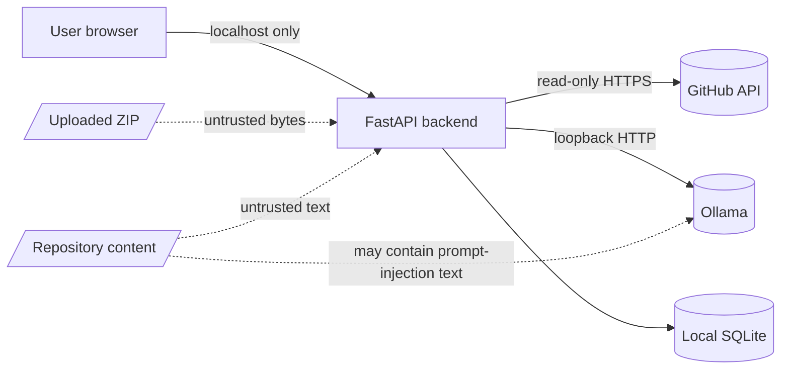

# Security

This document records what CodeMap protects, from whom, and how. It also lists the known weaknesses that were found during review, with a severity and a recommended fix for each.

- [1. Scope and assumptions](#1-scope-and-assumptions)
- [2. Trust boundaries](#2-trust-boundaries)
- [3. Controls in place](#3-controls-in-place)
- [4. Findings](#4-findings)
- [5. Residual risks](#5-residual-risks)
- [6. Reporting a vulnerability](#6-reporting-a-vulnerability)

---

## 1. Scope and assumptions

CodeMap is a **local-first developer tool**. It is designed to run on one user's machine, serving that user.

- The backend binds to `127.0.0.1` by default (Uvicorn's default host).
- The API has **no authentication**. This is intentional for a localhost tool, and it is only safe while the port stays private.
- Repositories and archives are **untrusted** and may be hostile.
- Ollama runs locally and is trusted as a model host. Its output is treated as untrusted text.

If you expose CodeMap to a network, to a shared machine, or behind a reverse proxy, you must add authentication and TLS first. Nothing in this project does that for you.

---

## 2. Trust boundaries

| Boundary | Trust level | Enforced by |
|---|---|---|
| Browser to backend | Trusted user on localhost | CORS allowlist for `localhost:3000`. Pydantic validation on every body. |
| Backend to GitHub | Semi-trusted network service | Public-only URL parsing, `follow_redirects=False`, timeouts, and size caps. |
| Archive to backend | **Untrusted** | ZIP validation before any read. |
| Backend to Ollama | Trusted local service, untrusted content | Loopback endpoint configuration. Prompts instruct the model to treat source as data. |

---

## 3. Controls in place

### Input handling

- **Strict request models.** Every JSON body is a Pydantic model with length limits. For example, `ExplainRequest.code` is capped at 20,000 characters, and `FolderAnalyzeRequest.files` at 1,000 entries.
- **GitHub URL allowlist.** `parse_github_url` accepts only `https://github.com/{owner}/{repo}` with validated character sets.
- **Source preview is inventory-bound.** `POST /api/repository/source` serves only paths that appear in the scanned inventory. It cannot be used to read arbitrary GitHub paths.
- **Project ID validation.** The index-delete endpoint requires `[a-f0-9]{24}`.

### ZIP handling (`services/zip_scanner.py`)

| Attack | Control |
|---|---|
| Archive too large | Upload capped at 50 MB, read with a bounded `file.read(limit + 1)`. |
| Too many entries | More than 5,000 entries is rejected. |
| Zip bomb (declared size) | Total declared uncompressed size is capped at 250 MB. |
| Path traversal (`../`) | Any `..` component is rejected. |
| Absolute paths, drive letters | Rejected. |
| Windows-style separators | Backslashes rejected. |
| Symlinks | Detected from `external_attr` and rejected. |
| Encrypted entries | Rejected through the encryption flag. |
| Duplicate names | Rejected, so one entry cannot shadow another. |
| Nested vendor or build folders | Skipped (`node_modules`, `.git`, `dist`, `venv`, and so on). |
| Null bytes in names | Rejected. |

Nothing is written to disk during inspection or analysis. Entries are read into memory, and each file is decoded as UTF-8 with replacement characters.

### Repository handling

- Code is **parsed**, never **imported or executed**. Python is analyzed with `ast.parse`. JavaScript and TypeScript are analyzed with regular expressions.
- GitHub requests disable redirects, so a response cannot silently send the backend somewhere else.
- Network calls have explicit timeouts (20 seconds).

### Output handling

- The frontend renders AI output and findings as plain text. **`dangerouslySetInnerHTML` is not used anywhere in the codebase.** That eliminates the most common XSS path for model output and repository content.
- Findings are labeled as heuristics. The scanner returns a note that findings require human review and are not proof of an exploitable bug, and the UI displays that note beneath the findings panel.

### Secrets

- Configuration is read from `.env`, which is git-ignored.
- `.env.example` contains no real secrets.
- The frontend receives only `NEXT_PUBLIC_API_URL`, which is public by design.

---

## 4. Findings

These are the weaknesses found in the review. None has been exploited in a public deployment, because the intended deployment is local. Severity reflects a local-tool threat model.

| ID | Severity | Area | Finding | Recommended fix |
|---|---|---|---|---|
| **SEC-01** | Medium | Availability | `analyze_github`, `analyze_local_folder`, `analyze_zip_upload`, and `clear_project_index` are `async def`, but they call synchronous SQLite and CPU-bound analysis. While a large analysis runs, the event loop is blocked, so status polling and other requests stall. | Run the synchronous portion in a thread with `await asyncio.to_thread(...)`, or make these handlers plain `def`. Keep the GitHub fetching async. |
| **SEC-02** | Medium | Authentication | There is no authentication. Anyone who can reach the port can start analyses, trigger GitHub requests, and query indexed source through `/ask-codebase`. | Keep the default `127.0.0.1` binding. Document this clearly. If remote use is ever needed, add a bearer-token dependency and require it on all `/api` routes. |
| **SEC-03** | Low | ZIP hardening | ZIP limits rely on **declared** sizes from the archive directory. Python's `zipfile` stops reading at the declared size, so the practical risk is low. Defense in depth would cap the bytes actually decompressed. | Read each entry through `archive.open()` in chunks and stop at the configured limit, rather than calling `archive.read()`. |
| **SEC-04** | Low | Input consistency | `ai/ask-codebase` validates `project_id` only by length (8 to 64 characters). `DELETE /index/{id}` requires the stricter `[a-f0-9]{24}` format. | Use one shared validator for project IDs on every endpoint that accepts one. |
| **SEC-05** | Low | Data sensitivity | Indexed source chunks persist in SQLite until they are explicitly cleared. Anyone with read access to `data/codemap.db` can read analyzed code. | Keep `data/` out of version control (already done). Mention the "Clear index" control in user-facing docs. Consider an opt-in `CODEMAP_PERSIST_INDEX=false`. |
| **SEC-06** | Info | Prompt injection | Repository text may contain instructions aimed at the model. The prompts tell the model to treat source as data, and the output is rendered as text, so injected instructions cannot run in the browser. They can still produce misleading explanations. | Keep the "AI output may be wrong" notice visible. Do not let model output drive any automated action. |
| **SEC-07** | Info | Dependencies | Dependency versions use ranges (for example, `fastapi>=0.115,<1.0`), and there is no lock file for either the backend or the frontend. | Commit `package-lock.json` and a pinned `requirements.lock`. Run `pip-audit` and `npm audit` in CI. |

---

## 5. Residual risks

- **Static findings are heuristics.** They can be false positives, and they can miss real issues. They are not a substitute for a security review or a dedicated SAST tool.
- **Local model quality.** An AI explanation can be confidently wrong. Treat it as a starting point for investigation.
- **GitHub availability.** Ingestion depends on the public GitHub API. Unauthenticated requests are limited to 60 per hour per IP. Heavy use will hit that limit and return `502`.
- **Denial of service on a shared machine.** Analyses are bounded, but a single very large repository can still consume significant CPU and memory while it runs.

---

## 6. Reporting a vulnerability

Please do not open a public issue for a security problem. Report it privately to the repository maintainer first, and allow a reasonable time for a fix before public disclosure.
